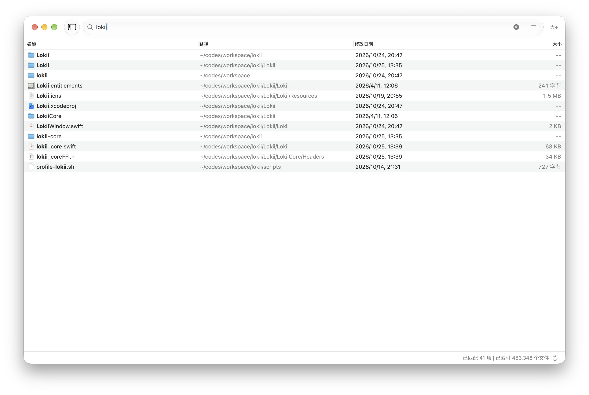

<p align="center">
  
</p>

<h1 align="center">Lokii</h1>

<p align="center">
  <b>Ultra-fast, lightweight native macOS instant file search tool — like Everything for Mac</b>
</p>

<p align="center">
  <a href="README.zh-CN.md"><b>简体中文</b></a> | <b>English</b>
</p>

<p align="center">
  <a href="https://github.com/huangy7/lokii/releases/latest"><b>Download for macOS (Apple Silicon & Intel)</b></a>
</p>

<p align="center">
  <a href="https://github.com/huangy7/lokii/releases/latest"></a>
  <a href="LICENSE"></a>
  
  <a href="https://github.com/huangy7/lokii/actions/workflows/ci.yml"></a>
  <a href="https://github.com/huangy7/lokii/releases"></a>
  
</p>

<p align="center">
  
</p>

Lokii is a native macOS instant file search tool engineered for developer-grade speed and desktop ergonomics — bringing the beloved, lightning-fast "Everything" file search experience to macOS. Powered by a high-performance in-memory index engine in Rust (`lokii-core`) bridged to a native Swift/AppKit user interface via UniFFI, Lokii delivers sub-millisecond query latency across hundreds of thousands of files with real-time FSEvents filesystem synchronization.

## Installation

### Homebrew (Recommended)

Install Lokii via Homebrew Cask from the official tap:

```bash
brew tap huangy7/tap
brew install --cask lokii
```

Or run directly in a single command:

```bash
brew install --cask huangy7/tap/lokii
```

### Direct Download

Download the prebuilt `.dmg` disk image for your Mac architecture from the [Releases page](https://github.com/huangy7/lokii/releases/latest):

| Architecture / Platform | Compatible Devices | Package (.dmg) |
| :--- | :--- | :--- |
| **Apple Silicon** | Mac with Apple Silicon (M1 / M2 / M3 / M4) | [Lokii-arm64.dmg](https://github.com/huangy7/lokii/releases/latest/download/Lokii-arm64.dmg) |
| **Intel** | Mac with Intel Core processors | [Lokii-x86_64.dmg](https://github.com/huangy7/lokii/releases/latest/download/Lokii-x86_64.dmg) |

Open the downloaded `.dmg` and drag `Lokii.app` into your `Applications` folder.

## Features

| Feature | Description |
| :--- | :--- |
| **Instant As-You-Type Search** | Sub-millisecond response latency across 500,000+ files with low memory footprint (under 100MB). |
| **Multi-Mode Engine & CJK/Pinyin** | Intelligent mode detection: substring, wildcard (`*`, `?`), regex (`^...$`), and fuzzy matching; native Chinese Pinyin (initials/full) and transparent CJK simplified/traditional bidirectional search. |
| **Path-Aware & Scoped Queries** | Path segment matching (`src/main.rs`), directory-only filtering (trailing `/` like `Desktop/`), and `in:<path>` scope prefix. |
| **Real-Time FSEvents Stream** | Checkpointed incremental replay (Cache v5) and native file-level FSEvents stream tracking additions, removals, modifications, and inode-based directory renames with near-zero CPU overhead; replays offline deltas on launch without rescanning disks. |
| **Command-Line CLI & Alfred** | Built-in `lokii` CLI for fast terminal search, structured `--json` output, and `--alfred` format integration over a high-concurrency local Unix domain socket. |
| **Native AppKit Density** | High-density virtualized table view, native macOS file icons, zebra striping, and spring-damped micro-interactions. |
| **Keyboard-First Workflow** | Global shortcut toggle (`⌘⇧Space`), arrow navigation, native Quick Look (`Space`), `Enter` to reveal in Finder, `⌘C` to copy path, and `Esc` to hide. |
| **Native Settings & Card UI** | Card-style preferences window with interactive file type tags, custom search roots and exclusions, theme switching, CLI integration management, and interactive Full Disk Access setup. |

The compact index shares filenames, parent paths, and extensions to reduce duplicate storage. Search materializes only the selected results while preserving matching and ordering behavior. Initialization failures display an error instead of reporting an empty index as ready. Whole-app performance validation is still pending; core-process measurements are not whole-app guarantees.

## Command-Line Tool (CLI)

Lokii includes a standalone native CLI tool `lokii` that communicates directly with the running application over a local Unix domain socket (`~/.config/lokii/query.sock`), sharing the in-memory inverted index for instant terminal searches with zero cold-start overhead.

Install it with one click from **Preferences → Terminal & Integrations** to `/usr/local/bin/lokii`, or invoke it directly from the app bundle:

```bash
# 1. Basic search (supports substring, Pinyin, and CJK traditional/simplified interop)
lokii search "documentation"
lokii search "kfgf"

# 2. Path and extension filters
lokii search "src/main.rs"
lokii search ".toml"

# 3. Structured JSON output (includes filename, path, size, modification time, and highlighted match ranges)
lokii search --json "lokii"

# 4. Alfred Workflow integration
lokii search --alfred "query"
```

## Why Lokii?

macOS comes with powerful system search tools, yet developers and power users consistently miss the simplicity and raw speed of Windows tools like voidtools Everything. Lokii was built to fill that gap.

### Lokii vs. Spotlight

- **Instant Filename Indexing**: Spotlight is designed for comprehensive metadata, email, and deep content indexing. In contrast, Lokii focuses exclusively on blazing-fast file and folder name indexing. It avoids the heavy background disk thrashing and indexing delays typical of Spotlight.
- **Deep Directory Visibility**: Spotlight frequently excludes, deprioritizes, or delays indexing hidden directories, build artifacts, and nested developer folders (`node_modules`, `target`, `.git`, `.venv`). Lokii scans and tracks the entire filesystem uniformly via direct FSEvents integration.
- **Developer Query Modes & CJK Search**: Lokii natively supports wildcards (`*.rs`, `test_*.swift`), regular expressions (`^IMG_.*\.png$`), path-scoped filters (`src/main.rs`, `in:Desktop`), and fuzzy typo correction; it deeply integrates Chinese Pinyin initials/full spelling alongside bidirectional CJK simplified/traditional interoperability without needing cumbersome query syntax.

### Lokii vs. Raycast & Alfred

- **Dedicated High-Performance Architecture**: While Raycast and Alfred are versatile productivity launchers, their file search commands rely under the hood on macOS's built-in Spotlight metadata service. When Spotlight has not indexed a file or is struggling with load, launcher file search inherits the exact same delay.
- **Ultra-Lightweight Resource Footprint**: Lokii's in-memory inverted index is written in Rust with compacted bitcode string tables, consuming under 100 MB of RAM while indexing over 500,000 files. It is an instant, keyboard-driven utility that opens in under 10 milliseconds and disappears the moment you press Escape.

## Privacy

Lokii runs 100% locally on your Mac. There are no user accounts, no telemetry, no tracking, and zero outbound network connections. Your filenames, directory structures, and search queries never leave your device.

## Build from Source

### Prerequisites

- macOS 13.0+
- Rust stable (2021 edition)
- Xcode 15+ (Swift 5.9+)

### Compiling and Running

```bash
# 1. Clone the repository
git clone https://github.com/huangy7/lokii.git
cd lokii

# 2. Build the app (generates UniFFI bindings & compiles Swift app)
make

# 3. Launch debug app
cd Lokii && .build/debug/Lokii
```

### Packaging DMG

To create a distributable `.app` and `.dmg`:

```bash
# Build for Apple Silicon (arm64)
make package ARCH=arm64

# Build for Intel (x86_64)
make package ARCH=x86_64
```

Output disk images will be generated in `output/Lokii-<arch>.dmg`.

## Community

- **GitHub Discussions**: [Ask questions, share workflows, and discuss ideas](https://github.com/huangy7/lokii/discussions)
- **Issue Tracker**: [Report bugs or submit feature requests](https://github.com/huangy7/lokii/issues)

## Contributing

Contributions, bug reports, and suggestions are welcome! Please check out [CONTRIBUTING.md](CONTRIBUTING.md) for details on setting up your local development environment and submitting pull requests.

## Contributors

<p align="center">
  <a href="https://github.com/huangy7/lokii/graphs/contributors">
    
  </a>
</p>

## License

Released under the [MIT](LICENSE) License.

---

<p align="center">
  Developed and maintained by <a href="https://github.com/huangy7">huangy7</a>
</p>
