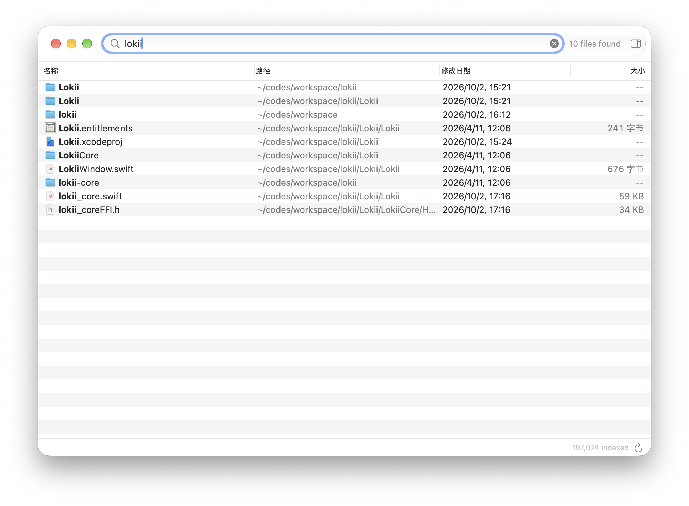

<p align="center">
  
</p>

<h1 align="center">Lokii</h1>

<p align="center">
  <b>极致轻量、亚毫秒级响应的 macOS 原生即时文件搜索工具 —— 专属于 Mac 的 “Everything” 体验</b>
</p>

<p align="center">
  <a href="README.md"></a>
  <a href="README.zh-CN.md"></a>
</p>

<p align="center">
  <a href="https://github.com/huangy7/lokii/releases/latest"><b>下载 macOS 版（支持 Apple Silicon 与 Intel）</b></a>
</p>

<p align="center">
  <a href="https://github.com/huangy7/lokii/releases/latest"></a>
  <a href="LICENSE"></a>
  
  <a href="https://github.com/huangy7/lokii/actions/workflows/ci.yml"></a>
  <a href="https://github.com/huangy7/lokii/releases"></a>
  
</p>

<p align="center">
  
</p>

Lokii 是一款专为 Mac 用户与开发者打造的原生即时文件搜索利器，为你带来类似 Windows 下 Everything 般极速、轻巧的文件检索体验。它基于高性能 Rust 内存倒排索引核心（`lokii-core`），通过 UniFFI 桥接至纯原生 Swift/AppKit 用户界面，在数十万文件的规模下依然提供亚毫秒级的输入即检索响应，并通过 FSEvents 实时监控文件系统的增量变更。

## 核心功能

| 功能 | 说明 |
| :--- | :--- |
| **亚毫秒级即时检索** | 输入即显示，50 万级别文件检索延迟低于 10ms，内存占用极低（低于 100MB）。 |
| **多模态搜索模式** | 智能模式识别：支持纯子串匹配、通配符（`*`, `?`）、正则表达式（`^...$`）以及模糊拼写纠错（Fuzzy）。 |
| **FSEvents 实时事件流** | 基于多路 FSEvents 增量事件流与防抖合并队列，实时跟踪文件增删改与目录重命名，索引 CPU 开销接近为零。 |
| **原生 AppKit 界面质感** | 高信息密度原生虚拟列表、自适应斑马纹、原生系统文件图标渲染与弹性阻尼视窗微动效。 |
| **全键盘极速流交互** | 全局快捷键呼出（`⌘⇧Space`）、方向键平滑导航、`Enter` 在访达中直达定位、`⌘C` 复制完整路径、`Esc` 瞬间隐藏。 |
| **持久化二进制缓存** | 带版本的 bitcode 缓存保存共享字符串表，自动读取旧版 v3 缓存，并在后台复核后保存为 v4。 |
| **原生偏好设置与权限指引** | 纯原生设置窗口：支持自定义索引目录、忽略规则、浅色/深色/跟随系统外观切换，以及完全磁盘访问拖拽授权指引。 |

紧凑索引共享文件名、父目录路径和扩展名，减少重复存储；搜索仅为最终选中的结果构建完整对象，保留原有匹配与排序行为。初始化失败时显示错误，不会把空索引误报为就绪。整个应用的性能验证尚未完成，核心进程数据不代表整个应用的性能保证。

## 为什么选择 Lokii？

macOS 自带了强大的聚焦搜索（Spotlight），但对于开发者和重度电脑用户来说，始终缺少类似 Windows 平台下 voidtools Everything 那种“纯粹、极速、无缝”的文件查找体验。Lokii 正是为此而生。

### Lokii 与 Spotlight 对比

- **专注文件名即时检索**：Spotlight 侧重全盘内容索引、邮件与网络信息聚合，后台持续建立大容量元数据索引，有时会产生较高的磁盘和 CPU 开销。Lokii 专注于文件名与路径检索，采用轻量级内存倒排索引，无后台过度写入，检索近乎零等待。
- **工程目录穿透覆盖**：Spotlight 常常对隐藏目录、开发构建产物（如 `node_modules`、`target`、`.git`、`.venv`）存在延迟收录或排除策略。Lokii 借助 FSEvents 系统事件流全量监听磁盘变动，所有深层代码目录一览无余。
- **极客搜索语法支持**：原生支持通配符（`*.rs`、`test_*.swift`）、正则表达式（`^IMG_.*\.png$`）与模糊纠错模式，无需繁琐的高级查询命令即可精确过滤。

### Lokii 与 Raycast / Alfred 对比

- **底层引擎的根本差异**：Raycast 和 Alfred 是功能丰富的一站式启动器（Launcher），但它们的文件搜索底层大多依赖系统 Spotlight 的元数据服务。若系统索引尚未建立或处于卡顿状态，启动器内的文件检索同样会受到牵连。
- **极致的轻量级与专注度**：Lokii 基于 Rust 构建高性能索引引擎，50 万级文件内存占用稳定在 100MB 以内，全局快捷键呼出窗口延迟低于 10ms，按 Esc 键瞬间隐入后台，是一款纯粹、无负担的桌面级生产力工具。

## 隐私与安全

Lokii 100% 运行在您的本地 Mac 上。没有任何用户账号体系，没有遥测（Telemetry），不发送任何网络请求。您的文件名、磁盘结构与搜索记录永远不会离开您的设备。

## 架构组成

```
lokii-core/       Rust 核心库 — 内存倒排索引、并行目录扫描器、FSEvents 监听队列、bitcode 持久化缓存
Lokii/            macOS Swift/AppKit 原生应用 — 高性能虚拟列表、系统托盘常驻、设置窗口
scripts/          构建与打包脚本（UniFFI 桥接生成、自动化 DMG 镜像装配）
```

## 从源码构建

### 环境要求

- macOS 13.0+
- Rust stable（2021 edition）
- Xcode 15+（Swift 5.9+）

### 编译与运行

```bash
# 1. 克隆代码仓库
git clone https://github.com/huangy7/lokii.git
cd lokii

# 2. 一键编译应用（自动生成 UniFFI 桥接并编译 Swift 前端）
make

# 3. 运行调试版应用
cd Lokii && .build/debug/Lokii
```

### 打包 DMG 安装镜像

通过 Makefile 一键构建独立发布的 `.app` 和 `.dmg`：

```bash
# 构建 Apple Silicon 架构版本 (arm64)
make package ARCH=arm64

# 构建 Intel 架构版本 (x86_64)
make package ARCH=x86_64
```

构建输出路径位于 `output/Lokii-<arch>.dmg`。

## 社区交流

- **GitHub Discussions 讨论区**：[交流使用心得、探讨功能规划与问题答疑](https://github.com/huangy7/lokii/discussions)
- **Issue 反馈**：[提交 Bug 报告或功能改进建议](https://github.com/huangy7/lokii/issues)

## 参与贡献

欢迎提交代码、提出改进建议或反馈问题！请参阅 [CONTRIBUTING.md](CONTRIBUTING.md) 了解本地开发环境搭建与 Pull Request 规范。

## 贡献者

<p align="center">
  <a href="https://github.com/huangy7/lokii/graphs/contributors">
    
  </a>
</p>

## 许可

基于 [MIT](LICENSE) 开源许可协议发布。

---

<p align="center">
  由 <a href="https://github.com/huangy7">huangy7</a> 开发与维护
</p>
