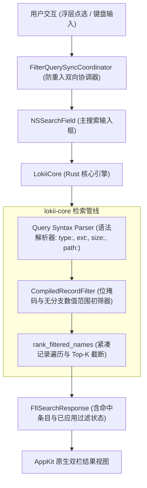

# Lokii 原生过滤气泡浮层（Filters Popover）技术设计规范

## 1. 概述与背景

Lokii 作为一款亚毫秒级、键盘优先的敏捷桌面检索工具，当前已支持基础的单文件类型过滤与内联查询语法（如 `type:doc`、`ext:rs`）。为了进一步提升高信息密度交互体验，满足用户对多维条件组合检索（多类型并集、文件大小区间、路径与模糊检索行为开关）的可视化操作诉求，本方案设计并实现**原生搜索过滤气泡浮层（Filters Popover）**。

### 核心设计原则
1. **输入框语法双向驱动（Syntax-Driven & Transparent）**：
   - 浮层并非独立封闭的状态黑盒，而是 Lokii 检索语法的**可视化投影与交互生成器**。
   - 浮层内的任何点选（多类型勾选、大小阈值调整、开关切换）均实时流式同步至主搜索框；
   - 用户在搜索框手动键入的语法（如 `lokii type:code,doc size:>10m`），也能在唤起浮层时精准逆向解析并回填各控件状态。
2. **极速实时即搜（Live Filtering）**：
   - 得益于 Lokii 紧凑内存索引的亚毫秒级性能，浮层内的每一次点击或数值变更**实时触发检索并流式刷新背后的主结果列表**，免去用户反复确认与二次点击的顿挫感。
3. **零堆分配与高吞吐保证**：
   - 核心层维持既有的内存经济性，文件大小与多类型掩码全部在紧凑记录遍历的第一道防线以 $O(1)$ 初筛剪枝，循环体内严禁任何堆分配。

---

## 2. 总体架构与数据流



---

## 3. 前端交互与 AppKit/SwiftUI 实现

### 3.1 浮层入口与载体 (`FilterPopoverController`)
- **入口按钮挂载机制**：
  - 在宿主视图 `searchContainer` 中，紧贴 `searchField` 右侧布局专用的过滤胶囊按钮，**独立于 `NSSearchField` 内部区域**，彻底规避与系统原生清除按钮（Cancel Button）的点击区域与视觉重叠冲突。
  - 按钮样式：原生过滤图标 `line.3.horizontal.decrease`，在未激活过滤时保持半透明低调视觉；在激活至少 1 项过滤条件时，亮起强调色并显示激活数量角标（如 `Filters (2)`）。
  - 全局快捷键：注册 `⌥F`（Option+F）快捷键快速唤起或收起浮层。
- **浮层容器**：
  - 基于 AppKit `NSPopover` 封装，采用系统级毛玻璃材质（`.hudWindow` 视觉深度），设置 `behavior = .transient`，支持按 `Esc` 或点击外部自动收起。
  - 内容视图使用 SwiftUI `FilterPopoverView` 通过 `NSHostingView` 桥接，兼顾声明式状态绑定与原生 AppKit 响应链。

### 3.2 浮层视图模块 (`FilterPopoverView`)
浮层面板宽度固定为 `330pt`，自上而下分为四大功能区：

1. **标题与全局重置**：
   - 顶部左侧标题“过滤条件”；
   - 顶部右侧高亮操作“全部清除（Clear All）”，一键清空所有已激活的过滤条件与对应语法。
2. **文件类型网格（File Types）**：
   - 顶部右侧带「全部 (All)」总控复选开关；
   - 2 列紧凑网格，涵盖 Lokii 专为生产力优化的 7 大分类：
     - `💻 代码 (Code)`：工程源码与配置文件（.rs, .swift, .ts, .py, .go, Makefile 等）
     - `📄 文档 (Documents)`：文档与电子书（.md, .pdf, .docx, .txt 等）
     - `🖼️ 图片 (Images)`：图像与设计资产（.png, .jpg, .svg, .webp 等）
     - `🎵 多媒体 (Media)`：音视频（.mp4, .mp3, .mov, .flac 等）
     - `📦 压缩包 (Archives)`：打包归档（.zip, .tar, .gz, .dmg 等）
     - `📁 文件夹 (Folders)`：目录条目
   - **多选机制**：支持任意组合多选。多选时生成逗号分隔语法 `type:code,doc`；全选或全不选时等价于全部放行（不产生冗余语法）。
3. **文件大小区间（File Size）**：
   - 「大于」复选框 + 数字输入框 + 单位下拉选择器（`MB` / `KB` / `GB` / `Bytes`）；
   - 「小于」复选框 + 数字输入框 + 单位下拉选择器；
   - 遵循 macOS 原生生态十进制规范（$1\text{MB} = 10^6$ 字节，$1\text{GB} = 10^9$ 字节），与系统访达及存储空间统计保持一致；
   - 生成语法规则：
     - 单独勾选大于：`size:>10m`
     - 单独勾选小于：`size:<500k`
     - 同时勾选形成区间：`size:10m..100m`
4. **检索行为开关（Search Behaviors）**：
   - `匹配完整路径 (Match Path)`：对应语法 `path:yes`，强制将查询文本作为多层级相对路径过滤；
   - `模糊跳字匹配 (Fuzzy Matching)`：对应显式切换至 Fuzzy 模式。
   - *(注：区分大小写与全字边界由于涉及底层逐字匹配算法改造，规划于后续阶段落地)*。
5. **底部操作栏**：
   - 右下角提供「完成」按钮，点击立即关闭浮层（所有变更在点选过程中已实时生效并流式刷新主视窗）。

### 3.3 双向协调器 (`FilterQuerySyncCoordinator`)

#### 防死循环重入守卫（Re-entrancy Lock）
为彻底规避 SwiftUI 状态更新与 AppKit 字段编辑器文本变化之间的乒乓循环（Ping-Pong Recursion），协调器设计显式的单向锁定状态：
```swift
final class FilterQuerySyncCoordinator {
    private var isSynchronizing = false

    /// UI 点选驱动搜索框语法变更
    func updateQueryFromUI(state: FilterState, in searchField: NSSearchField) {
        guard !isSynchronizing else { return }
        isSynchronizing = true
        defer { isSynchronizing = false }

        // 保存光标与选择区间，执行局部语法替换，防止 IME 组合中断
        applyStateToSearchField(state, searchField: searchField)
    }

    /// 搜索框键盘键入反向驱动 UI 状态回填
    func updateUIFromQuery(query: String, into state: inout FilterState) {
        guard !isSynchronizing else { return }
        isSynchronizing = true
        defer { isSynchronizing = false }

        parseQueryIntoState(query: query, state: &state)
    }
}
```

#### 局部语法替换与光标/输入法保护（Selection & IME Preservation）
在更新 `searchField.stringValue` 时，不采用粗暴的全量覆写方式，而是通过 `currentEditor()` 获取字段编辑器：
1. 若正在进行中文/多字节输入法组字（`hasMarkedText() == true`），暂缓语法同步，待组字完成（Commit）后再处理；
2. 记录当前的 `selectedRange`；
3. 将语法 Token（如 `type:...`, `size:...`）就地增删或于末尾追加，恢复原有光标偏移位置，保障键盘打字的连续性。

---

## 4. 核心层扩展与高性能初筛 (`lokii-core`)

### 4.1 语法扩展与安全解析 (`search/filter.rs`)

1. **复合文件类型与扩展名**：
   - `type:code,doc`：切分各分类，取其对应扩展名池位图的**并集（Union）**；
   - `ext:rs,swift,ts`：支持任意多后缀并集。
2. **文件大小区间解析与溢出守卫**：
   - 支持整数与浮点数输入（如 `size:>1.5m`，转换为 $1.5 \times 10^6 = 1,500,000$ 字节）；
   - 单位乘法全部采用 `saturating_mul` 防御，规避超大数值引起的整型溢出 Panic；
   - **区间颠倒容错**：若用户输入 `size:>100m size:<10m`，严格遵守数学逻辑无交集判定，直接返回空结果（零命中），无异常崩溃。
3. **路径检索强制标记**：
   - 解析到 `path:yes` 时，即使查询词中不含 `/`，亦强制路由至 `path_search`。

### 4.2 零堆分配高性能初筛器 (`CompiledRecordFilter`)

过滤器结构体内联纯标量，完全消除热循环中的 `Option` 解包分支：
```rust
pub struct CompiledRecordFilter {
    /// 扩展名池位图（多个选定类型的并集）
    valid_ext_mask: Vec<bool>,
    /// 是否存在类型限制（为 false 时直接放行扩展名判断）
    has_type_filter: bool,
    /// 是否包含特殊无后缀工程代码文件（如 Makefile、Dockerfile）
    allow_code_special: bool,
    /// 空扩展名槽位 ID
    empty_ext_id: Option<u32>,
    /// 是否允许目录
    allow_dirs: bool,
    /// 是否仅允许目录
    dirs_only: bool,
    /// 最小字节阈值 (默认 0)
    min_size_bytes: u64,
    /// 最大字节阈值 (默认 u64::MAX)
    max_size_bytes: u64,
    /// 是否激活了大小过滤
    has_size_filter: bool,
}
```

在 `matches_record` 记录初筛热路径中（每秒遍历上百万次）：
```rust
#[inline(always)]
pub fn matches_record<'a>(
    &self,
    record: &CompactRecord,
    resolve_name: impl FnOnce() -> Option<&'a str>,
) -> bool {
    // 1. 目录守卫：目录不参与大小比较
    if record.is_dir {
        // 大小过滤仅针对文件；若指定了大小过滤，目录不予命中
        return self.allow_dirs && !self.has_size_filter;
    }
    if self.dirs_only {
        return false;
    }

    // 2. 文件大小无分支范围比较 (单周期指令，零堆分配)
    if record.size < self.min_size_bytes || record.size > self.max_size_bytes {
        return false;
    }

    // 3. 扩展名位掩码初筛 (若未指定类型过滤，直接放行)
    if !self.has_type_filter {
        return true;
    }

    if let Some(&valid) = self.valid_ext_mask.get(record.extension as usize) {
        if valid {
            return true;
        }
    }

    // 4. 特殊无后缀工程代码文件惰性解析兜底
    if self.allow_code_special && self.empty_ext_id == Some(record.extension) {
        if let Some(name) = resolve_name() {
            return is_code_special_filename(name);
        }
    }

    false
}
```

---

## 5. 跨语言 FFI 契约设计

UniFFI 接口层延续高内聚设计：
- `SearchResponse` 扩展字段：
  - `applied_file_types: Vec<FfiFileType>`：返回本次查询实际生效的文件类型枚举列表；
  - `applied_min_size: Option<u64>` 与 `applied_max_size: Option<u64>`：返回解析后生效的大小边界，供前端精准点亮状态。

---

## 6. 测试与质量保证策略

1. **核心层单元测试 (`lokii-core/src/search/filter.rs`)**：
   - 验证 `type:code,doc` 与 `ext:rs,ts` 复合类型解析的位掩码并集正确性；
   - 验证 `size:>1.5m`、`size:<500k`、`size:10m..100m` 的浮点转换与安全边界；
   - 验证 `size:>100m size:<10m` 颠倒区间的零命中表现；
   - 验证仅有大小过滤无类型过滤时（`All` 状态），普通文件与目录的初筛放行逻辑。
2. **Swift 同步与防重入测试 (`SearchWindowTests.swift`)**：
   - 验证协调器并发调用下的重入守卫有效性，无死循环发生；
   - 验证带有中文输入法 markedText 时的状态保护；
   - 验证搜索框语法就地替换算法与光标位置保留逻辑。
3. **性能基准验证**：
   - 运行全量紧凑索引检索基准测试，验证大小与多类型过滤下单次检索耗时稳定在 0.5ms 以内。
